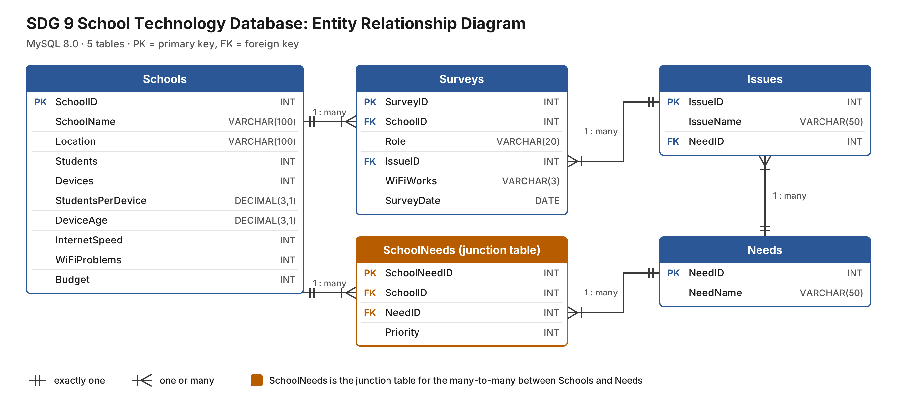
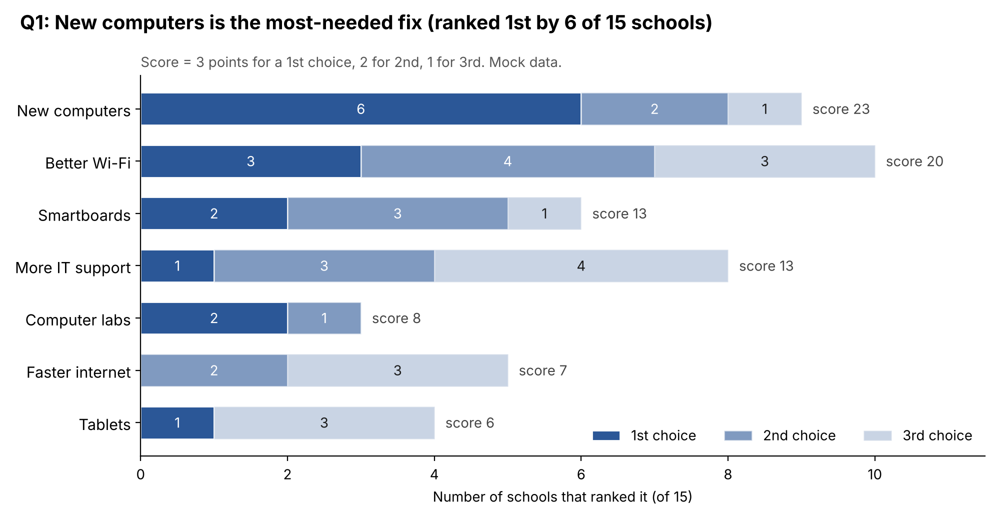

# SDG 9 Database Project Outline (Rough Draft)

## Topic

- Technology problems in underfunded schools
- Question: What technology improvements do underfunded schools need most so students can use technology for school?
- Using mock data for now (schools and numbers are made up)

## SDG

- SDG 9: Industry, Innovation and Infrastructure
- Goal includes access to technology and the internet for everyone
- Fits because schools need devices, internet and Wi-Fi
- Facts to use:
    - 2 out of 3 school-age kids in the world have no internet at home ([UNICEF and ITU, 2020](https://www.unicef.org/press-releases/two-thirds-worlds-school-age-children-have-no-internet-access-home-new-unicef-itu))
    - Almost half of schools in the world are not online ([Giga, 2024](https://swissinfo.ch/eng/international-geneva/the-un-plans-to-connect-every-school-to-the-internet-by-2030/83325727))
    - About 1 in 4 U.S. districts don't meet the FCC goal of 1 Mbps per student ([Connect K-12, 2023](https://www.govtech.com/education/k-12/report-3-in-4-school-districts-meet-fcc-internet-speed-standards))

## Data

- Would come from online forms sent to schools, saved as CSV files
- School form (one per school), staff survey (teachers, admins, IT staff), needs ranking (top 3 of 7)
- Mock data is in mock_data_outline.txt
- Mock data tables:
    - Schools: SchoolID, SchoolName, Location, Students, Devices, StudentsPerDevice, DeviceAge, InternetSpeed, WiFiProblems, Budget (15 schools)
    - Needs: NeedID, NeedName (7 needs)
    - Surveys: SurveyID, SchoolID, Role, MainIssue, WiFiWorks, SurveyDate (60 answers)
    - SchoolNeeds: SchoolNeedID, SchoolID, NeedID, Priority (45 rankings)

## Questions to answer

- Which upgrade do schools need most?
- Which schools have the most students per device?
- Does any school meet the FCC internet goal?
- Do schools with more Wi-Fi problems have staff saying the Wi-Fi is bad?
- Do schools that spend less have worse technology?
- Do teachers, admins and IT staff see different problems?
- Do staff problems match what the school ranked?
- Which schools should get help first?

## Database plan

- Use MySQL 8.0 (free, works for many schools at once, MySQL Workbench can run scripts and draw the ERD)
- Make an Access copy as a backup
- 5 tables: Schools, Surveys, Needs, Issues, SchoolNeeds
- Add an Issues table so the survey's main issue isn't typed out every time
- One-to-many: one school has many surveys
- Many-to-many: schools and needs, connected by SchoolNeeds
- Draft ERD (also ERD.pdf):

- Draft chart for the first question (also Q1_needs_ranking.pdf):

## Still need to make

- [ ] Create tables script
- [ ] Script to add the mock data
- [ ] Queries for each question
- [ ] Access backup
- [ ] Final ERD and charts (PNG or PDF)
- [ ] Write-up for the repo

## Sources

- United Nations, [Goal 9](https://sdgs.un.org/goals/goal9)
- UNICEF and ITU, [Two thirds of the world's school-age children have no internet access at home](https://www.unicef.org/press-releases/two-thirds-worlds-school-age-children-have-no-internet-access-home-new-unicef-itu), 2020
- SWI swissinfo.ch, [How the UN plans to connect every school to the internet by 2030](https://swissinfo.ch/eng/international-geneva/the-un-plans-to-connect-every-school-to-the-internet-by-2030/83325727), 2024
- GovTech, [Report: 3 in 4 school districts meet FCC internet speed standards](https://www.govtech.com/education/k-12/report-3-in-4-school-districts-meet-fcc-internet-speed-standards), 2023
- Gemini, used to make the mock data spreadsheet
- Our project proposal
